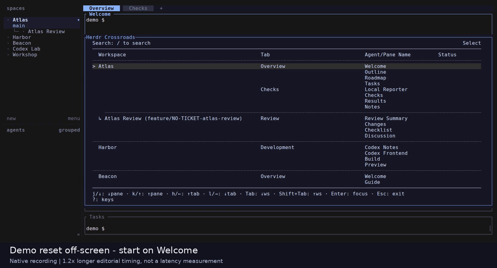
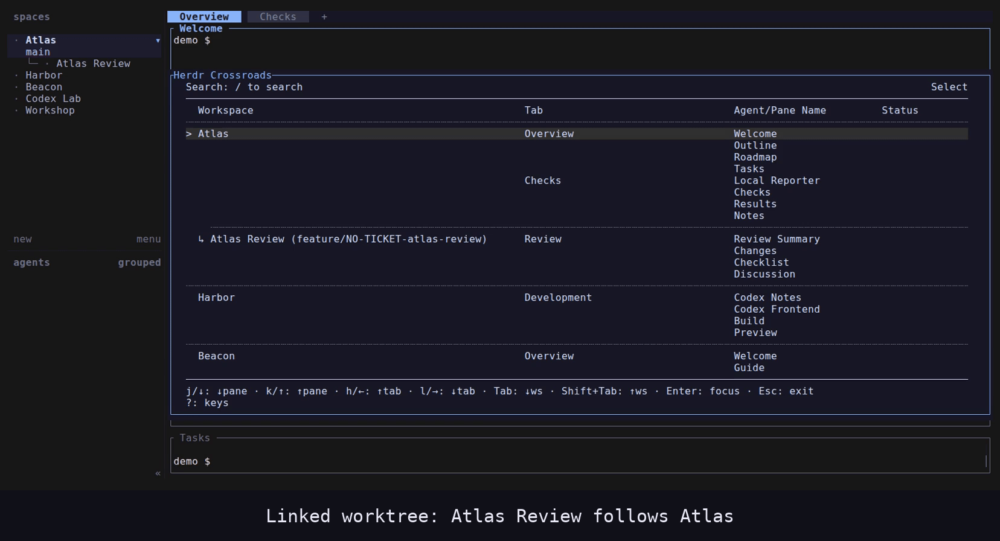
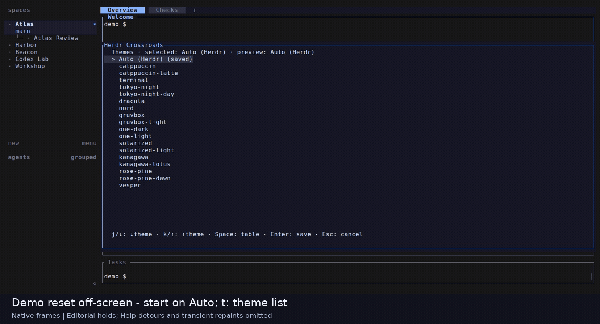

# Herdr Crossroads

A keyboard-and-mouse pane navigator for [Herdr](https://herdr.dev): search panes,
tabs, workspaces, or agent names and focus the pane you need without reorganizing
your session.

## Contents

- [Demo](#crossroads-demo---voiceover-by-elevenlabsio)
- [Features](#features)
- [Requirements and compatibility](#requirements-and-compatibility)
- [Installation](#installation)
- [Controls](#controls)
- [Configuration](#configuration)
- [Update and uninstall](#update-and-uninstall)
- [Documentation and license](#documentation-and-license)

## Crossroads Demo - voiceover by elevenlabs.io

https://github.com/user-attachments/assets/c86b3c7c-718b-4033-82f8-8910d97d7278

The demo uses AI-generated **ElevenLabs Free narration for noncommercial use only**.
The software's MIT license does not grant commercial reuse rights to that narration;
see [media terms, attribution and provenance](docs/media/README.md#narration-use-and-attribution).

## Features

- Workspace/tab/pane navigation with stable pane-ID focus, including duplicate names.
- Live, case-insensitive subsequence search without requerying or reordering Herdr topology.
- [Linked worktrees](docs/worktrees.md) grouped beside their source workspace with `↳` and branch context.
- Live local agent statuses, [theme previews](docs/themes.md), customizable keys, and searchable help.
- Current source builds add Agent-only cards, direct `--agent` starts, and
  `a`/`s` table switching; published 0.3.1 binaries do not include this feature.
- **Navigation-only:** no creation, movement, renaming, or deletion of session topology.
  Only confirmation changes focus; explicitly saving a theme changes plugin-owned files.
- Opening/searching uses local CLI/socket access and files, not network requests or updates.
  Only the explicit setup action below writes a host launch binding; opening/searching
  never changes Herdr configuration, native prefix `g`/`t` bindings, or other plugins.

<a id="navigation-and-search"></a>

Historical native previews (not current release verification):
[navigation and themes provenance](docs/media/recordings/native-loops.md).



Recordings predate mouse support and the current `f` search / Help Enter controls;
use the [current controls](#controls) below rather than the recorded key labels.



## Requirements and compatibility

[](https://github.com/eisenhauer-dev/herdr-crossroads/releases/tag/v0.3.1)
[](https://herdr.dev)
[](docs/installation.md)
[](docs/builds.md#runtime-and-verification-limits)

### Runtime

- **Linux x86_64 with glibc** (`x86_64-unknown-linux-gnu` only), `stty` on `PATH`,
  and a running Herdr session; manifest minimum **Herdr 0.9.1**.
- Released **0.2.0** adds **macOS 15.0+**, Apple Silicon and Intel, with explicit
  `MACOSX_DEPLOYMENT_TARGET=15.0`. Published 0.1.0 remains Linux-only.
- **0.3.1**, published on **2026-11-10**, provides binaries for Linux x86_64 glibc,
  macOS Apple Silicon/Intel and native Windows x86_64 GNU.
- Native **Windows 10/11 x86_64** is the intended Windows target; published assets
  do not establish Windows 10/11 certification or resolve the compatibility limits below.
  Native GNU Windows preparation CI
  passed on Windows Server 2025 on 2026-11-05; a user-reported basic
  Windows 11 source-build/link/live-popup test with Herdr 0.9.5 succeeded on
  2026-10-28. On 2026-11-10 the user also confirmed successful Windows keybinding
  setup and launch after Herdr's **Reload config** menu action using an updated
  source/linked checkout (exact OS build unrecorded). These are bounded user reports,
  not all-function, all-version or managed-install acceptance.
  See [Windows evidence and remaining gates](docs/builds.md#windows-preparation-not-certification).
- **80×15 popup content cells** minimum, excluding host borders; enlarge your terminal if needed.

### Managed installation

- Managed installation and opt-in keybinding setup require Git and **Python 3.11+**
  (standard library only); no Rust/Cargo required.
- Public downloads prefer existing **curl** on `PATH`; urllib is used only if curl
  is absent, never after a curl failure. See [download safeguards](docs/installation.md#validation-and-failure-behavior).
- Windows Schannel revocation errors have a disabled-by-default, explicit
  [best-effort workaround](docs/installation.md#optional-windows-schannel-revocation-workaround)
  in updated installer source, not the pinned `v0.3.0` installer; review its security trade-off first.

### Source builds

- Git, Rust/Cargo, and a system linker, in addition to the runtime requirements.
- Windows source preparation uses Rust `1.99.0-x86_64-pc-windows-gnu` and the
  approved MinGW-w64 POSIX/SEH/UCRT builder (GCC 15.2.0, exact observed Binutils
  build 2.46.0.20260210). The first successful GNU preparation at the `b5a86ed`
  source tree passed native runtime, package, exact installed-byte and upload gates
  on Windows Server 2025; Windows acceptance used a fake host, not real Herdr.
  The user approved only these nine additional imports on 2026-11-05 for preparation:
  `bcryptprimitives.dll` and the eight individually enumerated UCRT API-set
  contracts in [the bounded import exception](docs/builds.md#windows-gnu-toolchain-and-attribution).
  Private-contract Windows 10/11 compatibility remains **OPEN**, even if a later
  CI host passes; no API-set family wildcard or runtime DLL bundling is allowed.
  PE inspection retains its bounded 4 MiB capture; other commands and Cargo JSON
  retain 1 MiB.
  Offline comparison matched reported tool/input hashes to a public toolchain
  archive, not its historical download identity or exact source/patch state.
  The `b5a86ed` assets predate the added full MinGW ZPL notices and remain
  immutable prior-notice evidence, not current-release assets or distribution approval.
  The native preparation helper has
  [additional prerequisites](docs/builds.md#windows-preparation-not-certification).

### Compatibility status

- No architectures beyond the four published targets or SSH support are claimed; no minimum glibc
  or distribution compatibility guarantee. See [runtime limits](docs/builds.md#runtime-and-verification-limits)
  and [terminal limits](docs/keymaps.md#terminal-limits).
- **[0.1.0](https://github.com/eisenhauer-dev/herdr-crossroads/releases/tag/v0.1.0)
  is the first regular Linux release**, originally published as Latest with reviewed clean CI assets.
  [Public installation evidence](docs/installation.md#regular-010-public-installation)
  distinguishes pinned native navigation from unpinned CLI installation; no `0.1.0` upgrade cycle is claimed.
- Current Linux/Apple Silicon/Intel CI passed packaging, provenance and isolated
  real-Herdr installation with four full PTYs against each installed binary.
  Actual macOS Herdr live-popup acceptance was **waived, not performed**; automated
  evidence is not live-popup acceptance. Those historical results do not certify
  the Windows preparation. See [verified build evidence and limits](docs/builds.md#current-020-three-platform-ci-evidence).

## Installation

### Quickstart

Install [Herdr](https://herdr.dev) first and check the
[requirements](#requirements-and-compatibility). Linux/macOS uses `crossroads`;
Windows uses `crossroads-windows`. The updated setup action selects it automatically.
**Review the source, manifest, and assets before approving installation: it executes
code and registers a plugin globally for your user, not in a sandbox.**

#### 1. Install

```sh
herdr plugin install eisenhauer-dev/herdr-crossroads
```

> [!IMPORTANT]
> Installation alone does **not** write a Herdr launch binding. Explicitly opt in
> with [keybinding setup and success checks](#add-the-launch-binding-reload-and-open),
> then reload via the Herdr menu before using `prefix+f`.

This follows the public default branch (`main`) and downloads the checkout's matching
version and platform binary, currently **0.3.1** on all four published targets.
To pin the release checkout, use
`herdr plugin install eisenhauer-dev/herdr-crossroads --ref v0.3.1`.
However, the Windows config-ACL helper fix was merged after that tag in
[PR #20](https://github.com/eisenhauer-dev/herdr-crossroads/pull/20): the unpinned
install includes it, while `--ref v0.3.1` retains the earlier scripts.
The fix uses the existing 0.3.1 binary; it does not require a new release or rebuild.
See [installation options and safeguards](docs/installation.md) and
[historical public installation evidence](docs/installation.md#regular-010-public-installation).

<a id="add-the-launch-binding-reload-and-open"></a>

#### 2. Set up the keybindings and check success

Installation alone does not write host bindings. Current source setup explicitly
opts in to adding `prefix+f` for **Select** and `prefix+a` for **Agent** to Herdr's
user config. Both keys are checked before any config-content write; any conflict
aborts the entire update. Correct bindings are retained; only missing ones are added.
The Agent entry requires a rebuilt source binary and updated manifest; published
0.3.1 binaries do not implement `--agent`.

**Setup dispatcher:** requires a **0.3.1 or rebuilt source binary** with matching
manifest and helper; use a rebuilt source binary for the Agent entry above.
Published 0.3.0 binaries do not implement `--setup-keybind`; upgrade the binary too
when coming from 0.3.0. With a 0.3.1 binary already installed/built, the later Windows
ACL fix needs only the updated scripts in the actual managed/linked checkout,
including `scripts/setup-keybind.py` and `scripts/windows-files.py`.
See [Windows config safeguards](docs/installation.md#keyboard-launch-setup);
do not loosen ACLs to make setup work.
On Windows the action uses `python`; on Linux/macOS it uses `python3`, both **3.11+**
on the server's `PATH`. No interpreter alias is needed.

```sh
herdr plugin action invoke herdr-crossroads.setup-keybind
herdr plugin log list --plugin herdr-crossroads
```

Setup is asynchronous: repeat the log command until the invocation's matching
`log_id` has `status = "succeeded"`, `exit_code = 0`, and output confirming the
bindings were added or already configured at the expected config path.
**Do not reload on `running` or `failed`; resolve any error first.**
See [config paths, conflict handling, and safeguards](docs/installation.md#keyboard-launch-setup).

#### 3. Reload and open

Only after setup succeeds, choose **Reload config** in the **Herdr menu**.
In [Herdr 0.9.5][herdr-client-reload-095], this reloads both server configuration
and the current client's keymap. The server-only CLI command below can leave an
already-running client's shortcuts stale; if using it, restart the Herdr client too:

```sh
herdr server reload-config
```

Check `prefix+?` for the Crossroads bindings, then press `Ctrl+b`, then `f` for
Select or `a` for Agent (or your configured prefix). If a binding is missing,
verify the successful setup log's config path matches the running host before retrying.

To open directly from a shell in your running Herdr session, use your platform's
entrypoint (no launch binding required):

**Linux/macOS:**

```sh
herdr plugin pane open --plugin herdr-crossroads --entrypoint crossroads
```

**Windows:**

```powershell
herdr plugin pane open --plugin herdr-crossroads --entrypoint crossroads-windows
```

The `crossroads` entrypoint is Linux/macOS-only; on Windows it fails with
`platform_unsupported`. Use `crossroads-windows` instead.

Source builds also provide direct **Agent** entrypoints: use `crossroads-agent`
on Linux/macOS or `crossroads-agent-windows` on Windows in the commands above.
These require a rebuilt binary and updated manifest; published 0.3.1 binaries
do not implement `--agent`. No argument opens Select; `--agent` opens the existing
Agent cards immediately, with the same opening-snapshot membership and filtering.
Both views use a 90%×90% popup. Current source setup binds these entries to
`prefix+f` and `prefix+a`, respectively.

<details>
<summary>Manual keybinding setup</summary>

Edit `~/.config/herdr/config.toml` on Linux/macOS or
`%APPDATA%\herdr\config.toml` on Windows by default.
Overrides can change this: `herdr --help` shows the resolved path; see
[config-path selection](docs/installation.md#keyboard-launch-setup). Follow
[Herdr's versioned configuration guide][herdr-config].

First check `prefix+?` and your existing config for collisions on **both**
`prefix+f` and `prefix+a`; choose other free shortcuts if occupied. `prefix+f` is
unused in Herdr 0.9.1/0.9.3/0.9.5 defaults and suggests “find panes”. Preserve all
custom and default navigation/close bindings, including `prefix+g`, `prefix+t`,
and `prefix+x` (close pane). With a rebuilt source binary and updated manifest,
append only the missing entries for your platform, using free keys:

**Linux/macOS:**

```toml
[[keys.command]]
key = "prefix+f"
type = "shell"
command = "herdr plugin pane open --plugin herdr-crossroads --entrypoint crossroads"
description = "Open Herdr Crossroads"

[[keys.command]]
key = "prefix+a"
type = "shell"
command = "herdr plugin pane open --plugin herdr-crossroads --entrypoint crossroads-agent"
description = "Open Herdr Crossroads — Agent"
```

**Windows:**

```toml
[[keys.command]]
key = "prefix+f"
type = "shell"
command = "herdr plugin pane open --plugin herdr-crossroads --entrypoint crossroads-windows"
description = "Open Herdr Crossroads"

[[keys.command]]
key = "prefix+a"
type = "shell"
command = "herdr plugin pane open --plugin herdr-crossroads --entrypoint crossroads-agent-windows"
description = "Open Herdr Crossroads — Agent"
```

`shell` runs the launch command detached; the plugin manifest opens the popup.
The updated setup action selects the platform's entrypoint itself.
After manual setup, reload as above and press your configured prefix and chosen key.
This host launch binding is separate from `keymaps.jsonc`, which changes only
controls inside Crossroads. This manual-edit alternative is source-verified only;
see [setup source contracts](docs/installation.md#keyboard-launch-setup).

</details>

<a id="optional-customize-the-popup-size"></a>

#### Optional: customize the popup size

Both Linux/macOS and Windows entrypoints default to **90% width × 90% height**
of the terminal area in the shipped manifest. To override this temporarily for
one opening, for example at 75% width and height:

**Linux/macOS:**

```sh
herdr plugin pane open --plugin herdr-crossroads --entrypoint crossroads --width 75% --height 75%
```

**Windows:**

```powershell
herdr plugin pane open --plugin herdr-crossroads --entrypoint crossroads-windows --width 75% --height 75%
```

For a permanent customized launch binding, replace only the `command` value in
your own Herdr binding with the matching platform's command below, then choose
**Reload config** in the **Herdr menu** as [described above](#add-the-launch-binding-reload-and-open):

**Linux/macOS:**

```toml
command = "herdr plugin pane open --plugin herdr-crossroads --entrypoint crossroads --width 75% --height 75%"
```

**Windows:**

```toml
command = "herdr plugin pane open --plugin herdr-crossroads --entrypoint crossroads-windows --width 75% --height 75%"
```

Alternatively, in a trusted local checkout, change `width` and `height` in both
Select and Agent `[[panes]]` entries for your platform in `herdr-plugin.toml`
(`crossroads`/`crossroads-agent` or `crossroads-windows`/`crossroads-agent-windows`).

Setup writes the default command without size flags. Herdr
[v0.9.4][herdr-size-cli-094] / [v0.9.5][herdr-size-cli-095] source supports these flags,
[`1%`–`100%`][herdr-size-parser-094] ([v0.9.5 parser][herdr-size-parser-095]), and
CLI precedence over manifest defaults independently for each dimension
([v0.9.4][herdr-size-precedence-094], [v0.9.5][herdr-size-precedence-095]).
These examples are source-verified only, not executed. Percentages include host
borders and do not guarantee the required **80×15 popup content cells**.

<a id="optional-build-from-source"></a>

<details>
<summary>Optional: build from source</summary>

This is an alternative to managed installation, not a prerequisite. Explicitly
clone, build, and link a trusted source checkout:

```sh
git clone https://github.com/eisenhauer-dev/herdr-crossroads.git
cd herdr-crossroads
cargo build --release --locked
herdr plugin link "$PWD"
```

- Linking does not run build hooks. Keep the checkout and `target/release/herdr-crossroads`
  (`target/release/herdr-crossroads.exe` on Windows) in place; Cargo may download
  dependencies on a fresh machine.
- Use the platform-specific launch command or binding in the
  [Quickstart](#quickstart); the setup action selects the platform's entrypoint.
  See [setup requirements and safeguards](docs/installation.md#keyboard-launch-setup).
- All Select/Agent entrypoints default to 90% width × 90% height; see
  [popup sizing](#optional-customize-the-popup-size) for overrides and content-size limits.
- Basic Windows source-build/link/live-popup use was user-reported on 2026-10-28;
  the exact clone/build/link command sequence above has not been independently
  rerun here. Isolated installation evidence is recorded in the [installation guide](docs/installation.md).

</details>

## Controls

<a id="select-defaults"></a>

| Action | Default keys |
| --- | --- |
| Next / previous pane | `j` / `k`, or Down / Up |
| Next / previous tab | `l` / `h`, or Right / Left |
| Next / previous workspace | Tab / Shift+Tab |
| Search / reset filter | `f` / `r` |
| Select → Agent / Agent → Select | `a` / `s` |
| Keys help / themes | `?` / `t` |
| Focus selected pane and close | Enter |
| Close without focus | Esc or `q` |

- Keyboard movement wraps through visible panes/blocks without changing host focus.
- Agent shows only panes detected as agents when the popup opened, using the same
  navigation and shared search. Switching views keeps a visible pane ID selected,
  otherwise selects the first match (none for no matches), without changing host focus.
  Help and Themes return to the calling view; theme preview uses its filter and
  renders Agent cards or the unchanged Select table.
- Agent cards show agent/status and `Workspace › Tab › Pane`; only the selected
  card adds available repository, branch and `Titel:` details. Long fields clip
  to one line; hover selects/expands without focusing the host pane.
- Agent status keys: `a` all, `b` blocked, `d` done, `w` working, `i` idle, `u` unknown.
  Status intersects text search; `r` resets only text, `a` only status. Each popup
  starts at all; the Agent mode badge shows the active status. Agent search also
  matches available repository names, branches and explicit task titles, without
  extra queries. Status bindings are remappable and executable through Help.
- Agent membership is fixed by the opening snapshot; live events update statuses,
  not membership. Agent puts blocked panes first in stable transition order while
  retaining the selected pane ID; Select keeps topology order. Reconnect refreshes
  rows without adding newly detected agent panes;
  reopen to recapture membership. See [mapping and reconnect semantics](docs/keymaps.md#agent--agent-pane-navigation).
- Table headings are italic where supported. Empty results keep the table frame
  and show a centered message with effective reset/switch keys.
- While editing search, printable keys are text; Enter/Esc ends editing but retains
  the filter. Press Enter again to focus; no matches means no focus.
- Themes: `j`/`k` or arrows to preview, Space for list/table view, Enter to save,
  Esc/`q` to cancel. `?` shows the current view's effective keys.
- Help: Enter executes the marked action after returning to its calling view.
  A single left click executes the clicked action. Separate fixed mouse rows are informational.
- Mouse is enabled by default: hover highlights only; a single left click focuses
  a pane or saves a theme. Click the search bar to edit; the wheel scrolls only the
  viewport, preserving the highlighted item and host focus, without wrapping.
  Mouse gestures are not configurable bindings.
  See [mouse controls and opt-out](docs/keymaps.md#mouse-controls).
- See [complete controls, customization and input limits](docs/keymaps.md#actions-and-defaults).

## Configuration

<a id="configuration-and-complete-defaults-overview"></a>

No plugin-owned configuration is required; keyboard launch needs the opt-in or manual
[host binding setup](#add-the-launch-binding-reload-and-open) above.
Locate the plugin-owned directory with
`herdr plugin config-dir herdr-crossroads` (the host may create it), then reopen
Crossroads after editing.

| Optional file | Reference |
| --- | --- |
| `keymaps.jsonc` | [Action bindings, schema and defaults](docs/keymaps.md) |
| `theme.jsonc` | [Themes, Auto fallback and persistence](docs/themes.md) |
| `status-colors.jsonc` | [Status colors and precedence](docs/status-colors.md) |

- JSONC supports comments and trailing commas; legacy `.json` is read only when
  `.jsonc` is absent, never when it is invalid or unreadable.
- Keymaps and status colors are read-only. Saving a theme writes only plugin-owned
  theme files; explicitly saving Auto removes both theme files. See the references for failure behavior.
- In `keymaps.jsonc`, `"mouse_enabled": false` disables mouse capture. Enter is
  reserved: assigning it in any custom binding is a configuration error.

## Update and uninstall

- Close Crossroads before updating, rebuilding, or uninstalling; uninstall does not stop an open popup.
- Managed installs: Herdr 0.9.5 provides `herdr plugin update herdr-crossroads`;
  0.9.3 instead needs reinstalling a reviewed ref with matching assets.
  See [managed lifecycle and evidence](docs/installation.md#native-distribution-acceptance).
- Linked checkout: inspect local changes and the intended revision, update it,
  then rerun `cargo build --release --locked` if binary inputs (Rust code,
  dependencies or build settings) or the version change. Helper-only fixes use the
  existing matching binary: update the scripts in that linked checkout, not a
  separate clone. The link still points to that checkout. In particular, the
  post-v0.3.1 Windows ACL fix needs no rebuild
  when the binary is already 0.3.1; rerun setup and reload the client as above.
- Uninstall: `herdr plugin uninstall herdr-crossroads`. A local link leaves the
  checkout intact; managed checkout retention depends on Herdr's version and live leases.
  Plugin config/state remains: back up your files before any manual cleanup.
- Crossroads has no automatic updater; updating Herdr itself is a separate operation.

## Documentation and license

- [Troubleshooting by symptom](docs/troubleshooting.md)
- [Architecture](docs/architecture.md), [contributing and testing](CONTRIBUTING.md)
- [Build artifacts and verification limits](docs/builds.md), [release preparation](docs/releases.md)
- Software: [MIT](LICENSE), copyright 2026 SimonEisenhauer. Binary distributions
  retain `LICENSE` and [third-party notices](THIRD-PARTY-NOTICES.md); the existing
  `v0.1.0` release contains the equivalent HTML notices. Demo narration has
  [separate provider restrictions](docs/media/README.md#narration-use-and-attribution).

[herdr-config]: https://github.com/herdrdev/herdr/blob/v0.9.3/docs/versions/0.9.1/website/src/content/docs/configuration.mdx
[herdr-client-reload-095]: https://github.com/herdrdev/herdr/blob/v0.9.5/src/client/shell/actions.rs#L69-L78
[herdr-size-cli-094]: https://github.com/herdrdev/herdr/blob/v0.9.4/src/cli/plugin.rs#L725-L741
[herdr-size-cli-095]: https://github.com/herdrdev/herdr/blob/v0.9.5/src/cli/plugin.rs#L725-L741
[herdr-size-parser-094]: https://github.com/herdrdev/herdr/blob/v0.9.4/src/popup_size.rs#L20-L34
[herdr-size-parser-095]: https://github.com/herdrdev/herdr/blob/v0.9.5/src/popup_size.rs#L20-L34
[herdr-size-precedence-094]: https://github.com/herdrdev/herdr/blob/v0.9.4/src/app/api/plugins/panes.rs#L25-L31
[herdr-size-precedence-095]: https://github.com/herdrdev/herdr/blob/v0.9.5/src/app/api/plugins/panes.rs#L25-L31
