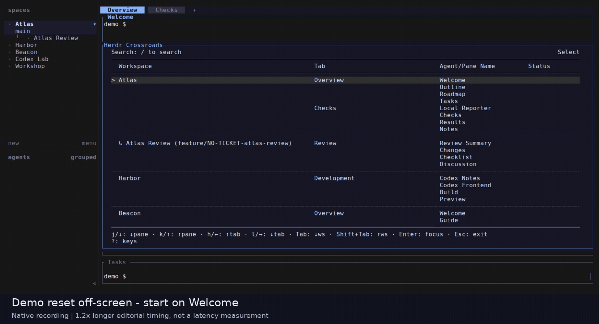
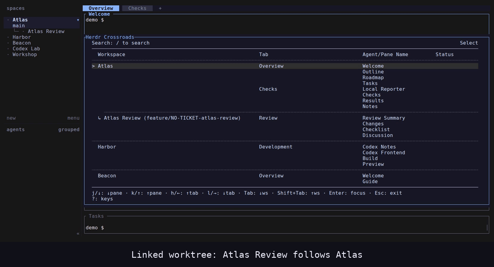
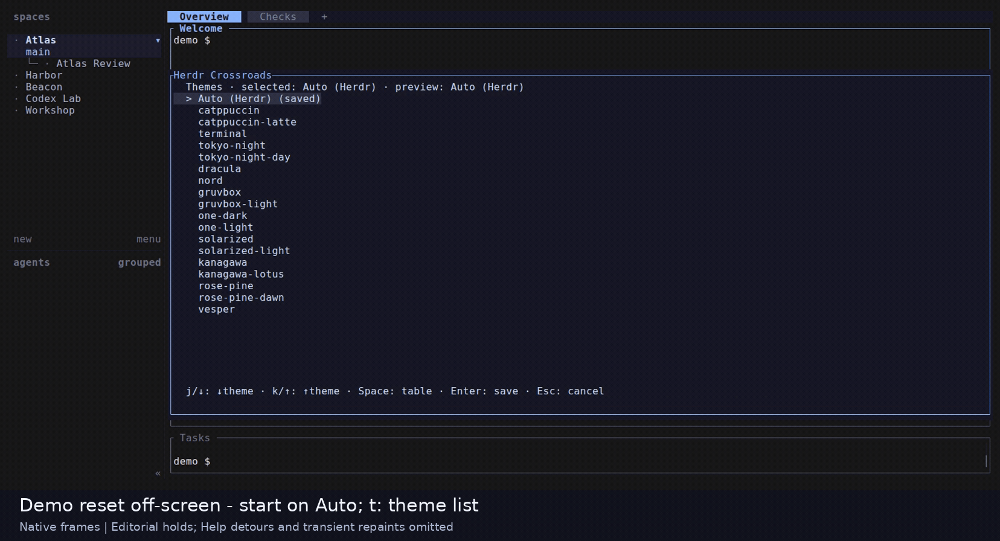

# Herdr Crossroads

A keyboard-driven pane navigator for [Herdr](https://herdr.dev). Crossroads
opens as a terminal popup, groups panes by workspace and tab, and lets you search
and focus a pane without reorganizing your session.

## Crossroads Demo - voiceover by elevenlabs.io

https://github.com/user-attachments/assets/c86b3c7c-718b-4033-82f8-8910d97d7278

The demo uses AI-generated ElevenLabs Free narration for noncommercial use only;
the software's MIT license does not grant commercial reuse rights to that narration.
See [media terms, attribution and provenance](docs/media/README.md#narration-use-and-attribution).

## Features

- Workspace/tab/pane navigation with stable pane-ID focus, even for duplicate names.
- Case-insensitive subsequence search across workspace, tab, pane, or agent names.
  Matches stay in topology order, never span fields, and are underlined; status
  text is not searched. Search updates on every character without requerying Herdr.
- Linked-worktree workspaces marked with `↳` and a branch when available, grouped
  after their source workspace. Failed worktree lookups leave ordinary labels.
- Live agent statuses over the local Herdr socket, with background reconnection.
- Compact inline statuses and a separate Status column at 110+ content columns.
- Searchable Keys help, replaceable navigation bindings, theme preview, and
  per-status color overrides.

Crossroads is **navigation-only**: it does not create, move, rename, or delete
workspaces, tabs, panes, or worktrees. Confirming a pane changes focus; explicitly
saving a theme changes only plugin-owned theme files. Opening and searching use
local CLI/socket access and local files, not network requests. They do not install
or update anything. Crossroads does not change Herdr's native prefix `g`/`t`
bindings, other plugins, or Herdr configuration.

### Navigation and search

Pane, tab, and workspace movement wraps in both directions through the filtered
rows and blocks. Browse without changing host focus; only confirming a pane
focuses it. Search matches workspace, tab, pane, or agent names without reordering
the topology. See [navigation controls](docs/keymaps.md#actions-and-defaults).



This older native clip uses Atlas/Welcome and Codex Frontend with an `odx` search;
it does not demonstrate current wrapping or contextual help. The three GIFs here
are retained historical captures with independently named ordinary shells and
editorial key captions below the UI, not recaptures for the current movie.
See [navigation/theme loop provenance](docs/media/recordings/native-loops.md).

### Linked worktrees

See linked workspaces beside their source workspace, with a `↳` marker and branch
context when available. Search and navigation retain that context even when the
source workspace is filtered out. See [linked workspaces and filtering](docs/worktrees.md).



This older clip selects Atlas Review and returns to Atlas without changing host
focus; its names differ from the movie's Atlas Shop and Atlas Checkout.

### Themes and help

Preview a theme in the list or pane table before saving. Contextual Keys help
shows the effective bindings for Select or Themes and has its own search filter.
See [themes](docs/themes.md) and [keys and help](docs/keymaps.md).



This older clip previews and saves Dracula while keeping Welcome selected; it
does not show the current contextual help.

Additional historical previews and their limits: [earlier native navigation](docs/media/navigation-demo.md)
and [synthetic previews](docs/media/README.md).

## Requirements and compatibility

- Linux, a running Herdr session, and Herdr **0.9.1 or later** (manifest minimum).
- For source builds: Rust/Cargo and a system linker. For prebuilt installation:
  a trusted versioned Release (or local assets) and Python 3.11+ (standard library only); no Rust/Cargo.
  `stty` is required on `PATH` at runtime.
- A terminal popup with at least **80×15 content cells**, excluding host borders.
  Smaller popups show an error page instead of allowing pane focus.
- Git to obtain/update a source checkout. Python 3.11+ is also used for local
  tests, not plugin runtime.

Crossroads 0.0.1 is the Linux-only test-version preparation. The planned public
acceptance sequence is 0.0.1 → 0.0.2 → 0.0.1, before 0.1.0 as the first regular
Linux release; no matching public test assets are available yet.
Local verification is on Linux x86_64;
macOS, Windows, other architectures, SSH sessions, and every outer-terminal/key
combination are not live-verified. The theme palette is based on Herdr v0.9.1;
host-command examples below were checked against v0.9.3 sources. On 2026-10-14,
an isolated native Herdr 0.9.3 server/client test verified local managed
installation, search/focus, replacement, version return, and uninstall at 160×40
with a fixture-only 90% popup manifest. The historical 0.1.0 license-bearing binary archive
also passed isolated real-Herdr 0.9.5 CLI and server/client installation tests on
2026-10-15, including delivered notices, search/focus, replacement/return and
uninstall; see [scope and hashes](docs/installation.md#native-distribution-acceptance).
These runs did not test personal-host setup or public distribution. A manifest
minimum is not a guarantee for every later
Herdr release. See [terminal limitations](docs/keymaps.md#terminal-limits).

## Installation

Install Herdr using its [versioned upstream installation guide][herdr-install].
For installer-managed Linux installations, that guide gives
`curl -fsSL https://herdr.dev/install.sh | sh`; this downloads and executes remote
code, so review the installer first. Package-manager installations should follow
their own installation/update workflow instead.

For Crossroads, obtain a trusted source checkout and run these commands **from
its repository root**:

```sh
cargo build --release --locked
herdr plugin link "$PWD"
herdr plugin list
```

The manifest launches `./target/release/herdr-crossroads` from the linked root.
Keep that checkout and its release binary in place. Linking registers a plugin
globally for your user and creates its config/state directories; it is not a
sandbox. Review the manifest and source before linking.

The manifest has a Python **version-pinned binary build hook**. With
`CROSSROADS_ASSET_DIR` absent it downloads the exact Linux x86_64 glibc archive and
checksum from `eisenhauer-dev/herdr-crossroads` GitHub Release `v<VERSION>`.
An explicit absolute `CROSSROADS_ASSET_DIR` selects trusted local assets instead;
empty/relative values fail without network fallback. It never compiles. Linking does not execute this
hook, so the source build-then-link route above is unchanged. See
[binary installation](docs/installation.md) for safety checks, requirements,
and isolated tests. **Public installation is prepared, not yet available or
accepted:** no matching tag/Release exists as of 2026-10-15. Once published and
accepted, the pinned route is
`herdr plugin install eisenhauer-dev/herdr-crossroads --ref v0.0.1`;
this is not currently a runnable public install instruction.
`herdr plugin install herdr-crossroads` is not valid
shorthand. Native local managed installation was tested; see
[its scope and evidence limits](docs/installation.md#native-distribution-acceptance).

From a shell in the running Herdr session, open the popup:

```sh
herdr plugin pane open --plugin herdr-crossroads --entrypoint crossroads
```

The manifest's default placement is `popup`, with no explicit dimensions; Herdr
defaults to a half-size popup. The installed Herdr 0.9.3 CLI help used for local
acceptance does not list `--width`/`--height` for this command. To request more space
in a trusted local checkout, add `width = "90%"` and `height = "90%"` to its
`[[panes]]` table before registration; these are manifest fields, not CLI flags.
The native acceptance fixture uses only its temporary manifest for that change.
Neither the default nor 90% can guarantee 80×15 content cells on a small terminal;
enlarge the terminal if needed. The fixture dimensions passed at 160×40 only.
No host keybinding is installed or required; the commands do not rebind prefix
`g`, `t`, or `x`. If another modal is open, Herdr may return `ui_busy`.

### Optional launch binding

For a keyboard shortcut, preserve your existing Herdr configuration and append
one command table to `~/.config/herdr/config.toml` on Linux (or the file selected
by `HERDR_CONFIG_PATH`):

```toml
[[keys.command]]
key = "prefix+f"
type = "shell"
command = '"${HERDR_BIN_PATH:-herdr}" plugin pane open --plugin herdr-crossroads --entrypoint crossroads'
description = "Open Crossroads"
```

`prefix+f` is unbound in Herdr 0.9.3 defaults. Check your active bindings with
`prefix+?` first; if you already use `f`, replace the key above with an unused
`prefix+` single key, for example `prefix+a`. Leave existing `g`/`t` navigation
and `x`/`shift+x` close bindings unchanged. Reload after editing:

```sh
herdr server reload-config
```

With the default prefix, press Ctrl+b, then f (not simultaneously). The detached
`shell` command uses Herdr's injected binary path, falling back to `herdr` on
`PATH`, and opens the registered plugin pane with its plugin environment.
`type = "pane"` runs a shell command, not a plugin entrypoint. Crossroads'
`keymaps.jsonc` controls only its internal UI, not this host launch shortcut;
the manifest does not install a default binding. The direct command above
remains a fallback. To remove the shortcut, delete only the added
`[[keys.command]]` table and reload again. See [Herdr's versioned configuration
guide][herdr-config].

**Execution status:** the source-build/link, launch-binding, reload and
configuration-directory examples remain unexecuted on a personal host. Local
managed install/reinstall/version-return/uninstall and popup search/focus passed
in the isolated native sandbox; this does not validate public installation.
Example syntax/lifecycle comes from Herdr's versioned
[plugin guide][herdr-plugins], [configuration guide][herdr-config], and
[v0.9.3 CLI implementation][herdr-cli]. The historical capture used
the plugin-opening route with `--session film --width 142 --height 30` in a
separate isolated environment. The current finishing cut compresses startup
and begins native footage at the complete popup; it does not show CLI execution
or validate personal-host configuration or general installation compatibility.

## Update and uninstall

Close Crossroads before rebuilding. In your linked checkout, inspect local
changes and the intended upstream revision, then update and rebuild:

```sh
git status --short
git pull --ff-only
cargo build --release --locked
```

The pull example assumes a clean branch with a configured upstream. For a pinned
or detached checkout, select and review the next revision instead. The link still
points at the same directory; reopen Crossroads to load the new binary and config.
If the checkout path changes, link the new root explicitly.

Herdr itself is separate: use `herdr update` only for Herdr-installer-managed
installations; otherwise update through the package manager. Herdr 0.9.3 has no
`plugin update` command; 0.9.5 provides one, but this command was not exercised
by the native acceptance test. The tested managed route reinstalls a reviewed ref.
Crossroads has no automatic updater. Close it before reinstalling a reviewed ref
with matching trusted assets (public Release or explicit local override), or uninstalling. A return to a previous ref
also requires that version's assets. The isolated native test verified replacement
and return using a test-only version fixture, not compatibility with a newly
released runtime. See [managed lifecycle and evidence](docs/installation.md#native-distribution-acceptance).

To uninstall **this local link only**:

```sh
herdr plugin uninstall herdr-crossroads
```

For a local link, this unregisters Crossroads without deleting your checkout.
`herdr plugin unlink herdr-crossroads` is the registration-only alternative.
With Herdr 0.9.3, managed uninstall removes Herdr's managed checkout. Herdr 0.9.5
removes registration but retains checkouts leased by live consumers; those become
eligible for later cleanup after the leases end. The native test verifies
unregistration and retained files, not that later reclamation. In all cases,
plugin config/state files are retained; inspect and back up your own files before
any manual cleanup. Do not remove other plugins or Herdr configuration.

## Configuration and complete defaults overview

No configuration files are required. To locate the plugin-owned directory:

```sh
herdr plugin config-dir herdr-crossroads
```

This host command may create the directory. Herdr injects its path as
`HERDR_PLUGIN_CONFIG_DIR`; Crossroads does not guess a global plugin-config path.
Each file is read once per opening. A `.jsonc` file takes precedence; legacy
`.json` is read **only when `.jsonc` is absent**, never when it is invalid or
unreadable. Reopen after editing. Comments and trailing commas are allowed, but
other JSON5 extensions and duplicate fields are not.

| File | Supported settings | Default / failure behavior |
| --- | --- | --- |
| `keymaps.jsonc` | `select`, `help`, `themes` action objects; one or two keys per action | Bindings below; invalid config opens the common error page |
| `theme.jsonc` | Exactly `{"theme":"<explicit built-in name>"}` | Absent: Auto (Herdr); invalid: Mocha plus an error notice |
| `status-colors.jsonc` | `working`, `blocked`, `done`, `idle`, `unknown`, each `#RRGGBB` | Active theme colors; invalid config opens the common error page |

There are no other plugin settings. Keymaps replace an action's whole key list;
omitted actions keep defaults. Conflicts are checked within each mode, including
unchanged defaults. No Ctrl/Alt bindings, macros, sequences, or disabling actions.
Keymaps and status colors are never written by Crossroads. The theme picker saves
an explicit choice atomically to `theme.jsonc` (without retaining comments), or
removes both theme files when Auto is explicitly saved. See the detailed references
for validation and failed-save behavior.

**Allowed custom keys:** case-sensitive single Unicode letters, numbers,
punctuation, or symbols (for example `j`, `J`, `!`, or `é`), ASCII space, and the
exact special names `Enter`, `Esc`, `Backspace`, `Up`, `Down`, `Left`, `Right`,
`Tab`, `Shift+Tab`, and `Space`. Write Shift-generated characters directly
(`!`, not `Shift+1`). Combining marks, control/format characters, private-use or
unassigned characters, other whitespace, and multi-character sequences are not
allowed. Neither are Ctrl/Alt combinations, F-keys, or other modified special
keys. Each action accepts one or two entries, checked before deduplication.
See [key syntax](docs/keymaps.md#key-syntax) for the exact Unicode-category rules
and JSON string examples.

### Select defaults

| Action | Keys |
| --- | --- |
| Next / previous pane | `j` / `k`, or Down / Up |
| Next / previous tab | `l` / `h`, or Right / Left |
| Next / previous workspace | Tab / Shift+Tab |
| Search / reset search | `/` / `r` |
| Keys help / themes | `?` / `t` |
| Focus selected pane and close | Enter |
| Close without focus | Esc or `q` |

Movement wraps in both directions and visits only visible rows/blocks. Tab and
workspace jumps select the first visible pane of the next/previous block. If the
remembered pane is filtered out, the first visible pane is the focus candidate. With no
matches, Enter does not focus anything. Focus failures do not retry a different pane.

### Help and Themes defaults

| Mode | Action | Keys |
| --- | --- | --- |
| Help | Next / previous entry | `j` / `k`, or Down / Up |
| Help | Search / reset independent help filter | `/` / `r` |
| Help | Return to calling Select or Themes view | Esc or `q` |
| Themes | Next / previous theme | `j` / `k`, or Down / Up |
| Themes | Toggle list / pane-table preview | Space |
| Themes | Save / cancel | Enter / Esc or `q` |
| Themes | Keys help (list or table preview) | `?` |

Keys help shows the caller's effective bindings under `Keys — Select` or
`Keys — Themes`. Help cycles through matching entries only; Themes cycles through
all offered themes in both list and table preview, without saving. Returning
preserves pane search, selection and viewport, and the pending theme cursor/preview
without saving or canceling. Existing search
rows show the current mode right-aligned (`Select`, `Search`, `Help`, `Themes`),
reserving query width for the label. Theme table preview remains `Themes`; the
theme list identifies itself with its existing Themes heading instead.

In pane/help **search editing**, printable characters (including `q`, `t` and `?`) are
text; Backspace erases, and Enter/Esc leaves editing while retaining the filter.
Help search is independent: Esc ends editing first; a subsequent default Esc
returns to the caller. Its mode label remains `Help` while editing.
Search editing is fixed, not configurable. Recognized Ctrl/Alt input is ignored;
classical terminals cannot distinguish physical Ctrl+i from Tab or Ctrl+m from
Enter. Standalone raw Esc has a 100-ms ambiguity delay. On error pages, fixed
Up/`k`, Down/`j` scroll and Enter/Esc/`q` closes without focus.

### Theme and status defaults

Auto (Herdr) recognizes a simple manual built-in theme from `HERDR_CONFIG_PATH`,
then `$XDG_CONFIG_HOME/herdr/config.toml`, then `$HOME/.config/herdr/config.toml`.
These are precedence choices, not fallbacks after a read failure. Missing,
unreadable, ambiguous, custom, or auto-switching config, and SSH environments,
fall back to Catppuccin Mocha. Auto does not follow live Herdr theme changes.

The 18 explicit choices are `catppuccin`, `catppuccin-latte`, `terminal`,
`tokyo-night`, `tokyo-night-day`, `dracula`, `nord`, `gruvbox`, `gruvbox-light`,
`one-dark`, `one-light`, `solarized`, `solarized-light`, `kanagawa`,
`kanagawa-lotus`, `rose-pine`, `rose-pine-dawn`, and `vesper`. Only `terminal`
inherits terminal default foreground/background; others paint their own panel.

| Status | Mocha fallback color |
| --- | --- |
| `working` | `#f9e2af` |
| `blocked` | `#f38ba8` |
| `done` | `#94e2d5` |
| `idle` | `#a6e3a1` |
| `unknown` / unrecognized snapshot status | `#6c7086` |

Explicit status overrides win over theme colors; omitted statuses follow the
active theme. Rows without an agent have no inline status.

### Runtime context (not additional settings)

Herdr supplies `HERDR_BIN_PATH` for local CLI calls (otherwise `herdr` on `PATH`)
and `HERDR_SOCKET_PATH` for status subscriptions and focus. Without a nonempty
socket path, the snapshot remains browsable but focus cannot succeed and live
status is disabled. A supplied `HERDR_PANE_ID` is excluded from the snapshot;
Herdr popups themselves have no pane ID. `COLUMNS` is only a width fallback when
`stty size` cannot provide one (otherwise 80 columns and 24 rows). SSH environment
variables affect Auto theme recognition, not a remote plugin transport feature.

## Verification and further reading

An isolated release-binary PTY run on **2026-10-02**, Linux x86_64, Rust/Cargo
1.93.1 and Python 3.14.4, measured 1,000 synthetic rows:

| Query | Matches | Keypress-to-view |
| --- | --- | --- |
| `x` | 3 | 3.06 ms |
| `xy` | 2 | 2.79 ms |
| `xyz` | 1 | 2.93 ms |

Command: `python3 tests/pty_latency.py target/release/herdr-crossroads`, after
`cargo build --release --offline`, from the repository root. The existing harness
requires each measured update to be ≤100 ms and checks that search issues no new
snapshot calls. These are three local synthetic measurements, **not historical
results, a live Herdr benchmark, or a universal latency guarantee**; opening time
and reconnect latency are not measured. See [contribution/testing](CONTRIBUTING.md).

- [Keymaps, JSONC schema, input limits, and complete PTY gates](docs/keymaps.md)
- [Troubleshooting by symptom](docs/troubleshooting.md)
- [Theme selection, persistence, and Auto limitations](docs/themes.md)
- [Status colors and override precedence](docs/status-colors.md)
- [Architecture, module responsibilities, and core flows](docs/architecture.md)
- [Developer and contribution guide](CONTRIBUTING.md)

Software licensed under [MIT](LICENSE), copyright 2026 SimonEisenhauer.
The demo narration has separate [provider restrictions](docs/media/README.md#narration-use-and-attribution).

[herdr-install]: https://github.com/herdrdev/herdr/blob/v0.9.3/docs/versions/0.9.1/website/src/content/docs/install.mdx
[herdr-plugins]: https://github.com/herdrdev/herdr/blob/v0.9.3/docs/versions/0.9.1/website/src/content/docs/plugins.mdx
[herdr-cli]: https://github.com/herdrdev/herdr/blob/v0.9.3/src/cli/plugin.rs
[herdr-config]: https://github.com/herdrdev/herdr/blob/v0.9.3/docs/versions/0.9.1/website/src/content/docs/configuration.mdx
