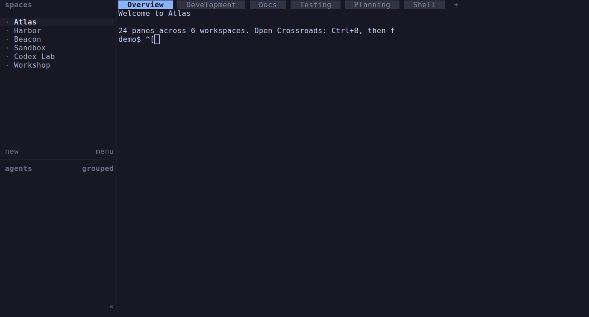
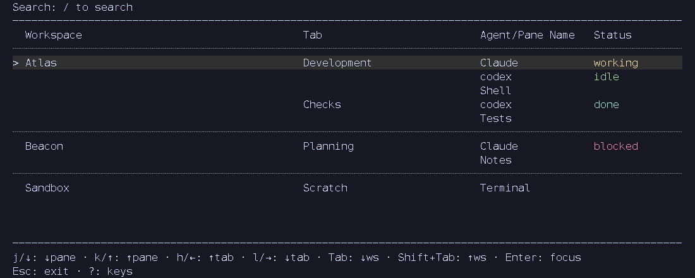

# Herdr Crossroads

A keyboard-driven pane navigator for [Herdr](https://herdr.dev). Crossroads
opens as a terminal popup, groups panes by workspace and tab, and lets you search
and focus a pane without reorganizing your session.

## Preview



Real isolated Herdr 0.9.3 session, captured from its own native terminal window;
the **24 panes across six workspaces** are ordinary shell panes with neutral names,
not running agents. The initial list fills the popup, with more panes below the viewport.
A **demo-only** Ctrl+B then `f` binding opens the binary in a 90% popup (not shipped plugin
registration). `/odx` filters to four panes across three workspaces, matching
pane names, workspace `Codex Lab`, and tab `Codex Tools` in `Workshop`, with
`o`, `d`, and `x` underlined in matching fields. Enter leaves search, `j` selects Codex
Frontend, and a **second Enter** focuses it and closes the popup. The final view
is Harbor → Development, with the destination split pane focused; host snapshots
confirm the pane/workspace/tab IDs. Tokyo Night was preselected in isolated
plugin config; this clip does not open Themes or save a theme.
See [native capture provenance and limits](docs/media/navigation-demo.md).

The following previews instead rasterize actual Crossroads output using synthetic
topology and a mock CLI/socket; they are not native Herdr screenshots.



Actual Crossroads output with synthetic demo data; not live Herdr screenshot.
The 110×20 content-cell overview shows workspace/tab groups and agent statuses.


Actual Crossroads output with synthetic demo data; not live Herdr screenshot.
The loop opens the Themes list with `t` and moves with `j` through Mocha, Latte,
terminal, Tokyo Night, Tokyo Night Day, and Dracula; the theme cursor, preview
name, and palette update live. Space briefly shows the pane-table preview, then
returns to the list.
Enter saves Dracula in isolated demo config and returns to the normal table
using that theme. Pane selection is unchanged; no pane focus is demonstrated.
See [synthetic capture provenance and rendering limits](docs/media/README.md).

## Features

- Workspace/tab/pane navigation with stable pane-ID focus, even for duplicate names.
- Case-insensitive subsequence search across workspace, tab, pane, or agent names.
  Matches stay in topology order, never span fields, and are underlined; status
  text is not searched. Search updates on every character without requerying Herdr.
- Linked-worktree workspaces marked with `↳` and a branch when available, grouped
  after their source workspace. Failed worktree lookups leave ordinary labels.
- Live agent statuses over the local Herdr socket, with background reconnection.
- Compact inline statuses and a separate Status column at 110+ content columns.
- Searchable Keys help, replaceable navigation bindings, theme preview, and
  per-status color overrides.

Crossroads is **navigation-only**: it does not create, move, rename, or delete
workspaces, tabs, panes, or worktrees. Confirming a pane changes focus; explicitly
saving a theme changes only plugin-owned theme files. Opening and searching use
local CLI/socket access and local files, not network requests. They do not install
or update anything. Crossroads does not change Herdr's native prefix `g`/`t`
bindings, other plugins, or Herdr configuration.

## Requirements and compatibility

- Linux, a running Herdr session, and Herdr **0.9.1 or later** (manifest minimum).
- Rust/Cargo and a system linker to build the plugin; `stty` on `PATH` at runtime.
- A terminal popup with at least **80×15 content cells**, excluding host borders.
  Smaller popups show an error page instead of allowing pane focus.
- Git to obtain/update a source checkout. Python 3.11+ is needed only for local
  PTY tests, not plugin runtime.

Crossroads 0.1.0 declares Linux only. Local verification is on Linux x86_64;
macOS, Windows, other architectures, SSH sessions, and every outer-terminal/key
combination are not live-verified. The theme palette is based on Herdr v0.9.1;
host-command examples below were checked against v0.9.3 sources, not exercised
in a live Herdr session. The native preview separately verifies search and
navigation/focus in one isolated v0.9.3 session with a custom popup binding,
not those installation
or plugin-link examples. A manifest minimum is not a guarantee for every later
Herdr release. See [terminal limitations](docs/keymaps.md#terminal-limits).

## Installation

Install Herdr using its [versioned upstream installation guide][herdr-install].
For installer-managed Linux installations, that guide gives
`curl -fsSL https://herdr.dev/install.sh | sh`; this downloads and executes remote
code, so review the installer first. Package-manager installations should follow
their own installation/update workflow instead.

For Crossroads, obtain a trusted source checkout and run these commands **from
its repository root**:

```sh
cargo build --release --locked
herdr plugin link "$PWD"
herdr plugin list
```

The manifest launches `./target/release/herdr-crossroads` from the linked root.
Keep that checkout and its release binary in place. Linking registers a plugin
globally for your user and creates its config/state directories; it is not a
sandbox. Review the manifest and source before linking.

There is currently **no manifest build hook**. Herdr's GitHub shorthand command
`herdr plugin install owner/repo` clones and runs only declared build hooks; it
does not automatically build this Rust binary. Use build-then-link rather than
treating a source-only managed install as ready to run. No published binary
distribution is assumed here.

From a shell in the running Herdr session, open the popup:

```sh
herdr plugin pane open --plugin herdr-crossroads --entrypoint crossroads --width 90% --height 90%
```

The manifest's default placement is `popup`, with no explicit dimensions; Herdr
defaults to a half-size popup. The example requests more space but still cannot
guarantee 80×15 content cells on a small terminal. Enlarge the terminal if needed.
No host keybinding is installed or required; the commands do not rebind prefix
`g` or `t`. If another modal is open, Herdr may return `ui_busy`.

**Execution status:** installation, linking, opening, configuration-directory,
update, and uninstall commands in this guide are unexecuted examples. Their
syntax/lifecycle comes from [Herdr's versioned plugin guide][herdr-plugins] and
[v0.9.3 CLI implementation][herdr-cli]. The native preview used a separate isolated
session and custom binary-launch binding; it did not exercise these commands.

## Update and uninstall

Close Crossroads before rebuilding. In your linked checkout, inspect local
changes and the intended upstream revision, then update and rebuild:

```sh
git status --short
git pull --ff-only
cargo build --release --locked
```

The pull example assumes a clean branch with a configured upstream. For a pinned
or detached checkout, select and review the next revision instead. The link still
points at the same directory; reopen Crossroads to load the new binary and config.
If the checkout path changes, link the new root explicitly.

Herdr itself is separate: use `herdr update` only for Herdr-installer-managed
installations; otherwise update through the package manager. Herdr's plugin v1
has no `plugin update` command: managed GitHub plugins are refreshed by reinstalling
(which still will not build Crossroads without a build hook).

To uninstall **this local link only**:

```sh
herdr plugin uninstall herdr-crossroads
```

For a local link, this unregisters Crossroads without deleting your checkout.
`herdr plugin unlink herdr-crossroads` is the registration-only alternative.
Plugin config/state files are retained; inspect and back up your own files before
any manual cleanup. Do not remove other plugins or Herdr configuration.

## Configuration and complete defaults overview

No configuration files are required. To locate the plugin-owned directory:

```sh
herdr plugin config-dir herdr-crossroads
```

This host command may create the directory. Herdr injects its path as
`HERDR_PLUGIN_CONFIG_DIR`; Crossroads does not guess a global plugin-config path.
Each file is read once per opening. A `.jsonc` file takes precedence; legacy
`.json` is read **only when `.jsonc` is absent**, never when it is invalid or
unreadable. Reopen after editing. Comments and trailing commas are allowed, but
other JSON5 extensions and duplicate fields are not.

| File | Supported settings | Default / failure behavior |
| --- | --- | --- |
| `keymaps.jsonc` | `select`, `help`, `themes` action objects; one or two keys per action | Bindings below; invalid config opens the common error page |
| `theme.jsonc` | Exactly `{"theme":"<explicit built-in name>"}` | Absent: Auto (Herdr); invalid: Mocha plus an error notice |
| `status-colors.jsonc` | `working`, `blocked`, `done`, `idle`, `unknown`, each `#RRGGBB` | Active theme colors; invalid config opens the common error page |

There are no other plugin settings. Keymaps replace an action's whole key list;
omitted actions keep defaults. Conflicts are checked within each mode, including
unchanged defaults. No Ctrl/Alt bindings, macros, sequences, or disabling actions.
Keymaps and status colors are never written by Crossroads. The theme picker saves
an explicit choice atomically to `theme.jsonc` (without retaining comments), or
removes both theme files when Auto is explicitly saved. See the detailed references
for validation and failed-save behavior.

**Allowed custom keys:** case-sensitive single Unicode letters, numbers,
punctuation, or symbols (for example `j`, `J`, `!`, or `é`), ASCII space, and the
exact special names `Enter`, `Esc`, `Backspace`, `Up`, `Down`, `Left`, `Right`,
`Tab`, `Shift+Tab`, and `Space`. Write Shift-generated characters directly
(`!`, not `Shift+1`). Combining marks, control/format characters, private-use or
unassigned characters, other whitespace, and multi-character sequences are not
allowed. Neither are Ctrl/Alt combinations, F-keys, or other modified special
keys. Each action accepts one or two entries, checked before deduplication.
See [key syntax](docs/keymaps.md#key-syntax) for the exact Unicode-category rules
and JSON string examples.

### Select defaults

| Action | Keys |
| --- | --- |
| Next / previous pane | `j` / `k`, or Down / Up |
| Next / previous tab | `l` / `h`, or Right / Left |
| Next / previous workspace | Tab / Shift+Tab |
| Search / reset search | `/` / `r` |
| Keys help / themes | `?` / `t` |
| Focus selected pane and close | Enter |
| Close without focus | Esc or `q` |

Movement stops at the ends and visits only visible rows/blocks. If the remembered
pane is filtered out, the first visible pane is the focus candidate. With no
matches, Enter does not focus anything. Focus failures do not retry a different pane.

### Help and Themes defaults

| Mode | Action | Keys |
| --- | --- | --- |
| Help | Next / previous entry | `j` / `k`, or Down / Up |
| Help | Search / reset independent help filter | `/` / `r` |
| Help | Return to pane table | Esc or `q` |
| Themes | Next / previous theme | `j` / `k`, or Down / Up |
| Themes | Toggle list / pane-table preview | Space |
| Themes | Save / cancel | Enter / Esc or `q` |

In pane/help **search editing**, printable characters (including `q` and `t`) are
text; Backspace erases, and Enter/Esc leaves editing while retaining the filter.
Search editing is fixed, not configurable. Recognized Ctrl/Alt input is ignored;
classical terminals cannot distinguish physical Ctrl+i from Tab or Ctrl+m from
Enter. Standalone raw Esc has a 100-ms ambiguity delay. On error pages, fixed
Up/`k`, Down/`j` scroll and Enter/Esc/`q` closes without focus.

### Theme and status defaults

Auto (Herdr) recognizes a simple manual built-in theme from `HERDR_CONFIG_PATH`,
then `$XDG_CONFIG_HOME/herdr/config.toml`, then `$HOME/.config/herdr/config.toml`.
These are precedence choices, not fallbacks after a read failure. Missing,
unreadable, ambiguous, custom, or auto-switching config, and SSH environments,
fall back to Catppuccin Mocha. Auto does not follow live Herdr theme changes.

The 18 explicit choices are `catppuccin`, `catppuccin-latte`, `terminal`,
`tokyo-night`, `tokyo-night-day`, `dracula`, `nord`, `gruvbox`, `gruvbox-light`,
`one-dark`, `one-light`, `solarized`, `solarized-light`, `kanagawa`,
`kanagawa-lotus`, `rose-pine`, `rose-pine-dawn`, and `vesper`. Only `terminal`
inherits terminal default foreground/background; others paint their own panel.

| Status | Mocha fallback color |
| --- | --- |
| `working` | `#f9e2af` |
| `blocked` | `#f38ba8` |
| `done` | `#94e2d5` |
| `idle` | `#a6e3a1` |
| `unknown` / unrecognized snapshot status | `#6c7086` |

Explicit status overrides win over theme colors; omitted statuses follow the
active theme. Rows without an agent have no inline status.

### Runtime context (not additional settings)

Herdr supplies `HERDR_BIN_PATH` for local CLI calls (otherwise `herdr` on `PATH`)
and `HERDR_SOCKET_PATH` for status subscriptions and focus. Without a nonempty
socket path, the snapshot remains browsable but focus cannot succeed and live
status is disabled. A supplied `HERDR_PANE_ID` is excluded from the snapshot;
Herdr popups themselves have no pane ID. `COLUMNS` is only a width fallback when
`stty size` cannot provide one (otherwise 80 columns and 24 rows). SSH environment
variables affect Auto theme recognition, not a remote plugin transport feature.

## Verification and further reading

An isolated release-binary PTY run on **2026-10-02**, Linux x86_64, Rust/Cargo
1.93.1 and Python 3.14.4, measured 1,000 synthetic rows:

| Query | Matches | Keypress-to-view |
| --- | --- | --- |
| `x` | 3 | 3.06 ms |
| `xy` | 2 | 2.79 ms |
| `xyz` | 1 | 2.93 ms |

Command: `python3 tests/pty_latency.py target/release/herdr-crossroads`, after
`cargo build --release --offline`, from the repository root. The existing harness
requires each measured update to be ≤100 ms and checks that search issues no new
snapshot calls. These are three local synthetic measurements, **not historical
results, a live Herdr benchmark, or a universal latency guarantee**; opening time
and reconnect latency are not measured. See [contribution/testing](CONTRIBUTING.md).

- [Keymaps, JSONC schema, input limits, and complete PTY gates](docs/keymaps.md)
- [Troubleshooting by symptom](docs/troubleshooting.md)
- [Theme selection, persistence, and Auto limitations](docs/themes.md)
- [Status colors and override precedence](docs/status-colors.md)
- [Architecture, module responsibilities, and core flows](docs/architecture.md)
- [Developer and contribution guide](CONTRIBUTING.md)

Licensed under [MIT](LICENSE), copyright 2026 SimonEisenhauer.

[herdr-install]: https://github.com/herdrdev/herdr/blob/v0.9.3/docs/versions/0.9.1/website/src/content/docs/install.mdx
[herdr-plugins]: https://github.com/herdrdev/herdr/blob/v0.9.3/docs/versions/0.9.1/website/src/content/docs/plugins.mdx
[herdr-cli]: https://github.com/herdrdev/herdr/blob/v0.9.3/src/cli/plugin.rs
